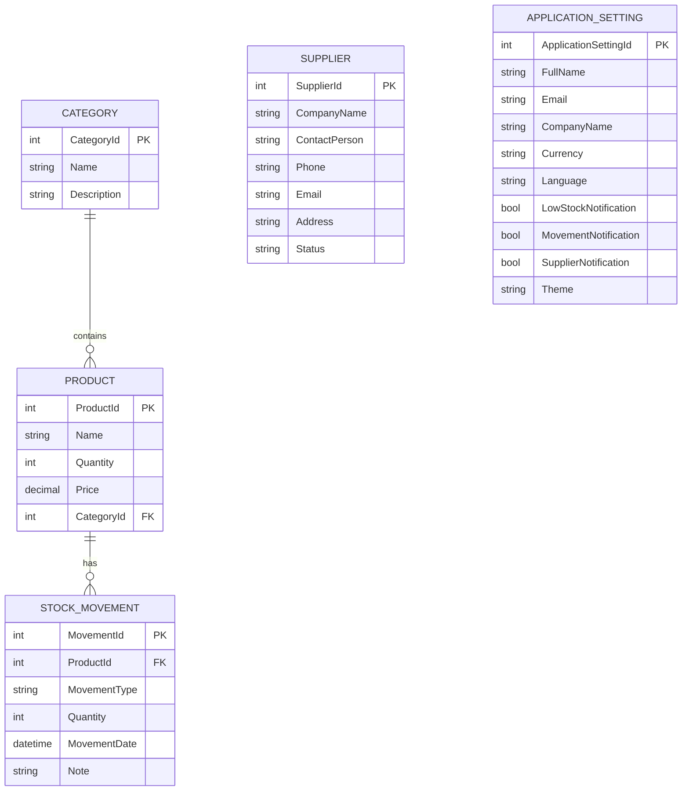

# NEXORA
### Inventory Management System


**NEXORA** is a Windows desktop inventory management application developed using **C#, WPF, .NET 10, Entity Framework Core, and Microsoft SQL Server**.

The application provides a centralized system for managing products, categories, stock movements, suppliers, and application settings.

NEXORA combines a modern desktop interface with a relational database to support inventory operations, stock monitoring, reporting, and persistent data management.

---

## 1. Project Overview

NEXORA was developed as a team project to demonstrate the implementation of a database-driven desktop application using object-oriented programming and relational database technologies.

The system is designed to simplify inventory operations while maintaining data consistency and providing a clear overview of stock information.

### Project Objectives

- Develop a user-friendly Windows desktop application.
- Implement Create, Read, Update, and Delete (CRUD) operations.
- Integrate a relational SQL Server database.
- Use Entity Framework Core for data access.
- Establish one-to-many relationships between database entities.
- Track incoming and outgoing inventory transactions.
- Provide real-time inventory summaries and reports.
- Preserve data across application sessions.

---

## 2. Main Features

### Dashboard

The Dashboard provides an overview of the inventory using live data retrieved from SQL Server.

Features include:

- Total number of registered products
- Total available stock quantity
- Number of low-stock products
- Total number of suppliers
- Five most recent stock movements
- Quick navigation to inventory operations

Dashboard statistics are refreshed when the user returns to the page.

### Product Management

The Products module supports full CRUD functionality.

- Add new products
- View existing products
- Update product details
- Delete products
- Assign products to categories
- Search and filter products
- Monitor stock quantities
- Display product availability status

Each product is associated with a category through a foreign key.

### Category Management

The Categories module allows users to organize products into groups.

- Create categories
- View all categories
- Edit category information
- Delete categories when permitted
- Display the number of products in each category
- Search existing categories

A category can contain multiple products.

### Stock Movements

The Stock Movements module records inventory transactions.

**Stock In**
- Increases the quantity of an existing product.
- Creates a transaction record in the database.

**Stock Out**
- Decreases the quantity of an existing product.
- Checks whether sufficient stock is available.
- Prevents stock quantities from becoming negative.

Additional functionality:

- Select products directly from SQL Server
- Record transaction quantities and notes
- Store movement dates
- View transaction history
- Search and filter stock movements
- Calculate total incoming and outgoing quantities

Database transactions ensure that stock updates and movement records are saved together.

### Supplier Management

The Suppliers module supports full CRUD functionality for supplier information.

- Add suppliers
- Edit supplier details
- Delete suppliers
- Search suppliers
- Filter by Active or Inactive status
- Store company names and contact information
- Display supplier statistics

Supplier records are stored persistently in SQL Server.

### Reports and Analytics

The Reports module provides inventory information based on actual database records.

Features include:

- Total product count
- Total available stock
- Estimated inventory value
- Low-stock item count
- Inventory summary
- Stock movement summary
- Low-stock report
- Export inventory data to CSV

Inventory value is calculated using:

`Total Value = Quantity × Unit Price`

The exported CSV contains product names, categories, quantities, prices, total values, and stock statuses.

### Application Settings

The Settings module stores application preferences in SQL Server.

Supported settings include:

- Administrator name and email
- Company name
- Preferred currency
- Preferred language
- Notification preferences
- Interface theme preference

Saved settings remain available after restarting the application.

**Note:** Currency and language selections are stored as preferences. Automatic currency conversion and full interface localization are not implemented. Dark Mode is currently unavailable, and notification preferences do not yet trigger an active notification service.

---

## 3. Technologies Used

| Technology | Purpose |
|---|---|
| C# | Main programming language |
| .NET 10 | Application framework |
| WPF | Windows desktop user interface |
| XAML | Interface design and layout |
| Entity Framework Core 10.0.14 | Object-relational mapping |
| Microsoft SQL Server Express | Relational database |
| LINQ | Database queries and data processing |
| EF Core Migrations | Database schema management |
| Visual Studio 2026 Community | Development environment |
| Git & GitHub | Version control and collaboration |

---

## 4. Application Architecture

NEXORA separates user interface code, business operations, and database access.

### Presentation Layer

The presentation layer is implemented with WPF and XAML.

It contains the application's windows, pages, forms, tables, navigation elements, and event handlers.

### Service Layer

The service layer handles operations between the interface and the database.

Examples:

- `ProductService`
- `CategoryService`
- `StockMovementService`
- `SupplierService`
- `DashboardService`
- `ApplicationSettingService`

Services are responsible for retrieving, validating, creating, updating, and deleting data.

### Data Access Layer

The data access layer uses Entity Framework Core.

Its main components are:

- `AppDbContext`
- `AppDbContextFactory`
- Entity models
- Database migrations

The connection string is configured in `appsettings.json`.

### Architecture Overview

```text
                NEXORA WPF APPLICATION
                          |
                          v
                  Presentation Layer
                   (XAML + C# Views)
                          |
                          v
                     Services
              (Business Logic & CRUD)
                          |
                          v
                 Entity Framework Core
                          |
                          v
                    SQL Server
                      NEXORA_DB
```

---

## 5. Database Design

The application uses a relational SQL Server database named:

**NEXORA_DB**

### Database Tables

| Table | Description |
|---|---|
| Categories | Stores product categories |
| Products | Stores product information and stock quantities |
| StockMovements | Stores incoming and outgoing inventory transactions |
| Suppliers | Stores supplier and contact information |
| ApplicationSettings | Stores persistent application preferences |

### Entity Relationships



### One-to-Many Relationships

**Category → Products**

One category may contain multiple products, while each product belongs to one category.

**Product → Stock Movements**

One product may have multiple stock movement records, while each movement refers to one product.

Foreign keys maintain referential integrity.

Deletion restrictions help prevent removing records that are referenced by related entities.

---

## 6. Project Structure

```text
NEXORA/
|
|-- InventoryManagementSystem.slnx
|-- README.md
|
|-- InventoryManagementSystem/
    |
    |-- Data/
    |   |-- AppDbContext.cs
    |   |-- AppDbContextFactory.cs
    |
    |-- Models/
    |   |-- Category.cs
    |   |-- Product.cs
    |   |-- StockMovement.cs
    |   |-- Supplier.cs
    |   |-- ApplicationSetting.cs
    |
    |-- Services/
    |   |-- CategoryService.cs
    |   |-- ProductService.cs
    |   |-- StockMovementService.cs
    |   |-- SupplierService.cs
    |   |-- DashboardService.cs
    |   |-- ApplicationSettingService.cs
    |
    |-- Views/
    |   |-- ProductsView.xaml
    |   |-- CategoriesView.xaml
    |   |-- StockMovementsView.xaml
    |   |-- SuppliersView.xaml
    |   |-- ReportsView.xaml
    |   |-- SettingsView.xaml
    |
    |-- Dialogs/
    |   |-- EnglishDialog.cs
    |
    |-- Migrations/
    |
    |-- MainWindow.xaml
    |-- MainWindow.xaml.cs
    |-- NexoraMessageBox.cs
    |-- appsettings.json
    |-- InventoryManagementSystem.csproj
```

---

## 7. Installation and Setup

### Prerequisites

Before running the application, install:

1. Windows 10 or Windows 11
2. Visual Studio 2026 Community with .NET Desktop Development
3. .NET 10 SDK
4. Microsoft SQL Server Express
5. SQL Server Management Studio (recommended)

### Step 1 — Clone the Repository

Open a terminal and run:

```bash
git clone https://github.com/tulin-bayar/NEXORA.git
cd NEXORA
```

### Step 2 — Open the Solution

Open the following file in Visual Studio:

```text
InventoryManagementSystem.slnx
```

Restore the project's NuGet packages if prompted.

### Step 3 — Configure SQL Server

Ensure that SQL Server is installed and its service is running.

Open:

```text
InventoryManagementSystem/appsettings.json
```

The default connection string is:

```json
{
  "ConnectionStrings": {
    "DefaultConnection": "Server=localhost;Database=NEXORA_DB;Trusted_Connection=True;TrustServerCertificate=True;"
  }
}
```

This configuration uses Windows Authentication.

If SQL Server Express is installed as a named `SQLEXPRESS` instance, the server value may need to be changed to:

```text
Server=.\SQLEXPRESS
```

Use the SQL Server instance name configured on your own computer.

### Step 4 — Create the Database

In Visual Studio, open:

**Tools → NuGet Package Manager → Package Manager Console**

Set the default project to:

`InventoryManagementSystem`

Then run:

```powershell
Update-Database
```

Entity Framework Core will apply the existing migrations and create the required database tables.

### Step 5 — Run the Application

In Visual Studio, press:

**F5**

Alternatively, from the repository root:

```powershell
dotnet run --project InventoryManagementSystem/InventoryManagementSystem.csproj
```

The NEXORA desktop application should open.

### Important Database Note

The GitHub repository contains the application source code and EF Core migrations.

It does **not** contain the developer's local SQL Server database records.

Each team member should configure their own SQL Server connection and apply the migrations.

A newly created database starts without inventory data.

---

## 8. Example Usage

A typical inventory workflow is:

1. Open NEXORA.
2. Create a category, such as Electronics.
3. Add a product named Wireless Mouse.
4. Assign the product to Electronics.
5. Enter its quantity and unit price.
6. Open Stock Movements.
7. Record a Stock In transaction.
8. Record a Stock Out transaction.
9. Return to Products to check the updated quantity.
10. Open Dashboard to review inventory statistics.
11. Open Reports to export inventory data to CSV.

Example stock calculation:

| Operation | Quantity | Remaining Stock |
|---|---:|---:|
| Initial stock | 30 | 30 |
| Stock In | +10 | 40 |
| Stock Out | -5 | 35 |
| Attempt Stock Out | -50 | Rejected |

The application prevents outgoing transactions that exceed available stock.

---


## 9. Team Members and Responsibilities

NEXORA is a collaborative project developed by a three-member team.

The project work is organized into three equally important technical areas: backend and database development, frontend and user interface development, and application modules and quality assurance.

### Tülin Bayar
**Role: Backend & Database Developer**

Responsibilities:

- Design and configure the SQL Server database.
- Implement Entity Framework Core integration.
- Develop database entities and relationships.
- Create and manage database migrations.
- Implement CRUD operations and data access services.
- Develop stock management business logic.
- Implement Stock In and Stock Out transactions.
- Ensure data consistency and validation.
- Integrate database services with application modules.
- Test database connectivity and data persistence.

### Aygul Guliyeva
**Role: Frontend & UI/UX Developer**

Responsibilities:

- Design the WPF application interface using XAML.
- Develop the main window and navigation system.
- Implement the Dashboard user interface.
- Develop Products and Categories management screens.
- Create interactive forms, buttons, and tables.
- Implement user interface event handling.
- Design Stock Movements and Suppliers interfaces.
- Create Reports and Settings screen layouts.
- Maintain visual consistency across the application.
- Test navigation and user interactions.

### Gokhan Percem
**Role: Application Modules & Quality Assurance Developer**

Assigned responsibilities:

- Review and improve the Suppliers module.
- Improve reporting functionality and data presentation.
- Enhance CSV export functionality.
- Review and improve Settings form validation.
- Implement additional error handling where necessary.
- Improve user feedback for invalid operations.
- Validate inventory report calculations.
- Develop and execute functional test cases.
- Fix defects identified during testing.
- Support final application integration and documentation.

### Team Contribution Structure

| Team Member | Primary Area | Target Workload |
|---|---|---|
| Tülin Bayar | Backend and Database | 33% |
| Aygul Guliyeva | Frontend and UI/UX | 33% |
| Gokhan Percem | Application Modules and Quality Assurance | 34% |

Each team member is responsible for a major part of the project and participates in the final application demonstration.

The team combines database engineering, desktop interface development, application functionality, and quality assurance to deliver a complete inventory management system.


---

## 10. Testing and Validation

The application has been manually tested for the following operations:

| Test Case | Result |
|---|---|
| Create, read, update, and delete products | Passed |
| Create, read, update, and delete categories | Passed |
| Create, read, update, and delete suppliers | Passed |
| Record Stock In transactions | Passed |
| Record Stock Out transactions | Passed |
| Reject insufficient-stock transactions | Passed |
| Display database-driven Dashboard statistics | Passed |
| Display database-driven inventory reports | Passed |
| Export inventory data to CSV | Passed |
| Save and reload application settings | Passed |
| Preserve records after restarting the application | Passed |

These results describe manual functional testing. An automated test suite is not currently included in the repository.

---

## 11. Current Limitations

The current implementation focuses on the core inventory management functionality.

- The application is designed for Windows desktop environments.
- SQL Server must be available locally or through a configured connection.
- The interface is primarily in English.
- Currency selection does not automatically convert product prices.
- Language selection does not translate the entire interface.
- Notification preferences are saved, but an active notification system is not implemented.
- Dark Mode is not yet supported.
- CSV files use comma-separated values; Excel may require an explicit delimiter selection depending on regional settings.

These features may be extended in future versions.

---

## 12. Future Improvements

Potential enhancements include:

- Dark Mode support
- Multilingual interface localization
- Currency formatting and exchange-rate conversion
- Automated low-stock notifications
- Advanced inventory charts and visual analytics
- Additional reporting and export formats
- User authentication and role-based permissions

---

## 13. Conclusion

NEXORA demonstrates how a modern WPF desktop application can be integrated with a relational SQL Server database using Entity Framework Core.

The project implements inventory management, CRUD operations, relational data modeling, transaction-based stock updates, reporting, and persistent application settings.

It also demonstrates team collaboration by combining frontend interface development with backend and database integration.

**NEXORA — Inventory Management Made Simple.**
